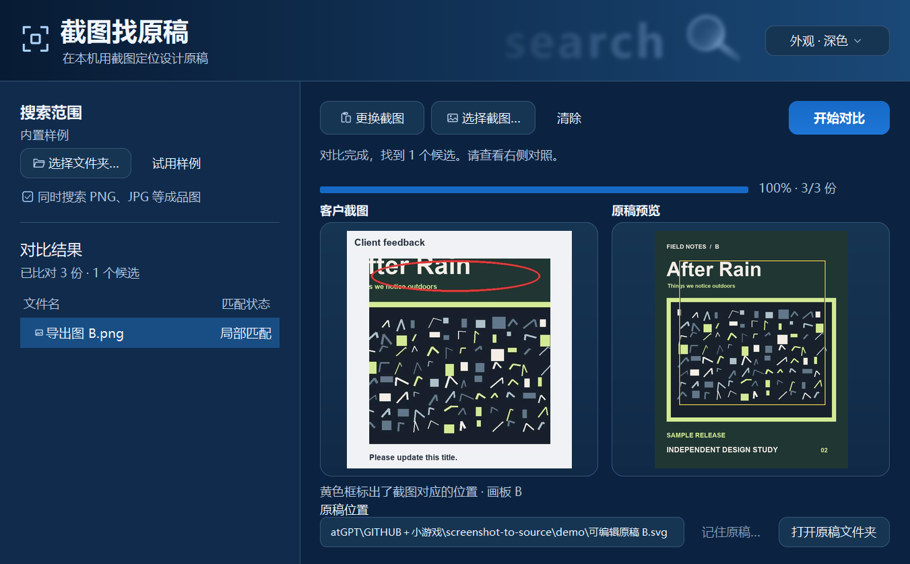

# Honey（截图溯源）

「截图找原稿」是一款 Windows 桌面工具。只有客户发来的截图，也能在本机找到对应的设计原稿。按 **Ctrl+V** 粘贴截图，选择搜索文件夹，再点 **开始对比**。找到候选后，可以并排核对画面，并在资源管理器里选中文件。

**[下载 Windows 版（x64）](https://github.com/hami066/Honey/releases/latest/download/screenshot-to-source-windows-x64.zip)** · [观看演示视频](https://github.com/hami066/Honey/releases/latest/download/screenshot-to-source-demo.mp4) · [版本说明](https://github.com/hami066/Honey/releases/latest)



Honey (Screenshot to Source) is an offline Windows desktop app that finds local PSD, PSB, PDF and PDF-compatible AI files from cropped or annotated screenshots. It can also compare exported images and remember their linked source files. It runs without an account, API key or Internet connection.

## 一分钟试用

1. 下载 Windows 便携 ZIP，并解压整个压缩包。
2. 打开 `ScreenshotToSource.exe`，保留同目录的 `_internal` 和 `demo` 文件夹。
3. 点 **试用样例 → 开始对比**。选中 **导出图 B** 后，点 **在文件夹中定位**，资源管理器会选中已关联的 **可编辑原稿 B.svg**。

首发包在 Windows 10 x64 上验证。Windows 可执行文件未签名，受管设备请使用公司批准的软件部署流程。需要核对下载完整性时，可从 [Release 页面](https://github.com/hami066/Honey/releases/latest) 获取 `SHA256SUMS.txt`。

## 用在自己的项目里

1. 按 **Ctrl+V** 粘贴截图，或把图像文件拖进「客户截图」区域。也可以点 **选择截图**。
2. 选设计稿所在的文件夹，点 **开始对比**。搜索会包含子文件夹，进度条显示已处理份数。
3. 对比完成后，桌面角落会弹出提示，有候选时会播放提示音。点左侧候选核对预览，再点 **在文件夹中定位**。如果结果是成品图，可以点 **记住原稿** 保存关联。

右上角的 **外观** 提供跟随系统、浅色和深色三种选项。

## 支持的格式

| 格式 | 可用于比对的画面 |
| --- | --- |
| PSD、PSB | 文件保存时的合成图，支持常见 RGB、灰度和 CMYK 的 8 位或 16 位画面，单张上限 4800 万像素 |
| PDF、AI | 本机渲染出的页面，AI 需要保存 PDF 兼容内容，结果显示匹配页码 |
| PNG、JPG、JFIF、WebP、BMP | 勾选「同时搜索 PNG、JPG 等成品图」后参与比对，单个图像文件上限 96 MB |

## 安全边界

对比在本机运行，程序没有上传、账号、遥测或在线分析接口。截图、预览和匹配特征在内存中处理。「记住原稿」会在当前搜索文件夹保存路径关联，外观偏好会保存在 Windows 的当前用户设置中。完整读写范围和部署条件见 [SECURITY.md](SECURITY.md)。

遇到问题可在 [Issues](https://github.com/hami066/Honey/issues) 提交 Windows 版本、文件格式和复现步骤。需要附图时，请用可公开的样例。

## 从源码运行

使用带 Tkinter 的 64 位 Python 3.12。下载依赖通常需要联网。安装完成后可以断网运行。

```powershell
py -3.12 -m venv .venv
.\.venv\Scripts\python.exe -m pip install -r requirements.txt
.\.venv\Scripts\python.exe app.py
```

```powershell
.\.venv\Scripts\python.exe -m unittest discover -s tests -v
.\.venv\Scripts\python.exe app.py --self-test
```

## 构建和发布 Windows 下载包

```powershell
.\.venv\Scripts\python.exe -m pip install -r requirements-build.txt
.\tools\Build-Windows.ps1 -Python .\.venv\Scripts\python.exe
```

GitHub 仓库的根目录使用这里的源码目录。发布时创建一个 Release，把生成的 `screenshot-to-source-windows-x64.zip` 和 `SHA256SUMS.txt` 上传到该 Release。普通用户下载 Release 里的 Windows ZIP 即可运行。GitHub 自动生成的 Source code ZIP 供读代码或自己构建的人使用。

## 实现

图片和原稿预览在本机用 OpenCV 比对局部特征。长图按交叠区间比较。Photoshop 使用原文件保存的合成画面。PDFium 在内存中渲染 PDF 页面及 Illustrator 中的 PDF 兼容内容。页面匹配返回对应文件和页码，稿件仍由原设计软件编辑。

源码和自制样例采用 MIT 许可。Windows 下载包包含各自许可下的第三方组件，许可文件随包分发。
