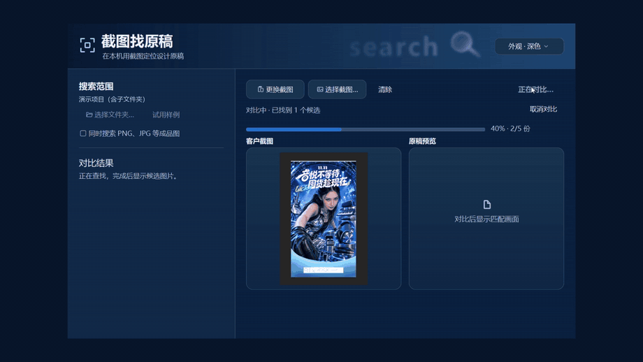

# Screenshot to Source（截图溯源）

客户只发来一张截图？用它在本机找对应的设计原稿。粘贴截图，选择搜索文件夹和文件格式，再点 **开始对比**。找到候选后，可以并排核对画面，并在文件管理器里选中文件。

**[下载 Windows 版（x64）](https://github.com/hami066/screenshot-to-source/releases/latest/download/screenshot-to-source-windows-x64.zip)** · [观看演示视频](https://github.com/hami066/screenshot-to-source/releases/latest/download/screenshot-to-source-demo.mp4) · [版本说明](https://github.com/hami066/screenshot-to-source/releases/latest)

[](https://github.com/hami066/screenshot-to-source/releases/latest/download/screenshot-to-source-demo.mp4)

Screenshot to Source finds local design and office files from cropped or annotated screenshots. Search only the file formats you select. It runs without an account, API key or Internet connection.

## 一分钟试用

1. 在 [版本页](https://github.com/hami066/screenshot-to-source/releases/latest) 下载适用的 ZIP，再完整解压。
2. Windows 打开 `ScreenshotToSource.exe`，保留同目录的 `_internal` 和 `demo`。macOS 打开 `Screenshot to Source.app`，Apple 芯片对应 `arm64`，Intel 对应 `x86_64`。
3. 点 **试用样例 → 开始对比**。选中 **导出图 B** 后，点 **在文件夹中定位**，系统的文件管理器会选中已关联的 **可编辑原稿 B.svg**。

Windows 可执行文件未签名。macOS ZIP 如果出现在版本页，会单独注明测试系统、签名及 Apple 公证状态。受管设备请使用公司批准的软件部署流程。可从版本页下载相应的 SHA-256 文件核对下载完整性。

## 用在自己的项目里

1. Windows 按 **Ctrl+V**，macOS 按 **⌘V**。也可以拖入图片或点 **选择截图**。
2. 选文件夹，点 **搜索格式** 勾选要查找的类型，再点 **开始对比**。例如只勾 PSD，就只解码 PSD 来比对。搜索包含子文件夹，进度条显示已处理份数。
3. 对比完成后，桌面角落会弹出提示，有候选时会播放提示音。点左侧候选核对预览，再点 **在文件夹中定位**。如果结果是成品图，可以点 **记住原稿** 保存关联。

右上角的 **外观** 提供跟随系统、浅色和深色三种选项。

## 支持的格式

| 格式 | 可用于比对的画面 |
| --- | --- |
| PSD、PSB | 文件保存时的合成图，支持常见 RGB、灰度和 CMYK 的 8 位或 16 位画面，单张上限 4800 万像素 |
| PDF、AI | 本机渲染出的页面，AI 需要保存 PDF 兼容内容，结果显示匹配页码 |
| Sketch `.sketch`、Figma `.fig` | 使用 Sketch 保存的页面预览，或 Figma 本地副本封面。只有预览里能看到的画面参与匹配 |
| PPTX、DOCX、XLSX | 文件里已保存的 PNG 或 JPEG 缩略图。未保存缩略图、内页或其他工作表可先导出成 PDF，再用 PDF 查找 |
| PNG、JPEG、JFIF、WebP、TIFF、GIF、BMP | 在「搜索格式」中按需勾选。单个文件上限 96 MB，TIFF 和 GIF 只读首帧 |
| TXT 和手填后缀 | 无需截图也能列出文件。可按文件名筛选，TXT 还可查找 UTF-8、带 BOM 的 UTF-16 或 GB18030 内容（最多 4 MiB） |

默认选择 PSD、PSB、AI 和 PDF。「试用样例」使用独立的 PNG 选项，回到自己的目录会恢复你的选择。缩略图有时只有封面的一小部分，截到的内容越完整，越有机会匹配。

例如要找 CorelDRAW 或 InDesign 原稿，在「搜索格式」里的「其他后缀」填 `.cdr, .indd`。应用会列出这些文件并提供定位。用截图搜索时，结果会区分画面匹配与后缀匹配。后缀结果较多时显示前 500 项，可加关键词缩小范围。

## 安全边界

对比在本机运行，程序没有上传、账号、遥测或在线分析接口。截图、预览和匹配特征在内存中处理。「记住原稿」会在当前搜索文件夹保存路径关联，外观偏好保存在操作系统的当前用户设置中。完整读写范围和部署条件见 [SECURITY.md](SECURITY.md)。

遇到问题可在 [Issues](https://github.com/hami066/screenshot-to-source/issues) 提交 Windows 版本、文件格式和复现步骤。需要附图时，请用可公开的样例。

## 从源码运行

使用带 Tkinter 的 64 位 Python 3.12。下载依赖通常需要联网。安装完成后可以断网运行。

```powershell
py -3.12 -m venv .venv
.\.venv\Scripts\python.exe -m pip install -r requirements.txt
.\.venv\Scripts\python.exe app.py
```

```powershell
.\.venv\Scripts\python.exe -m unittest discover -s tests -v
.\.venv\Scripts\python.exe app.py --self-test
```

## 构建和发布 Windows 下载包

```powershell
.\.venv\Scripts\python.exe -m pip install -r requirements-build.txt
.\tools\Build-Windows.ps1 -Python .\.venv\Scripts\python.exe
```

GitHub 仓库的根目录使用这里的源码目录。发布时创建一个 Release，把生成的 `screenshot-to-source-windows-x64.zip` 和 `SHA256SUMS.txt` 上传到该 Release。普通用户下载 Release 里的 Windows ZIP 即可运行。GitHub 自动生成的 Source code ZIP 供读代码或自己构建的人使用。

## 在 macOS 上运行或构建

使用带 Tk 的原生架构 Python 3.12。在 Apple 芯片和 Intel 主机上分别构建，ZIP 会按架构命名。

```bash
python3.12 -m venv .venv
.venv/bin/python -m pip install -r requirements-build.txt
.venv/bin/python app.py
bash tools/build-macos.sh .venv/bin/python
```

## 实现

图片和原稿预览在本机用 OpenCV 比对局部特征。长图按交叠区间比较。Photoshop 使用原文件保存的合成画面。PDFium 在内存中渲染 PDF 页面及 Illustrator 中的 PDF 兼容内容。页面匹配返回对应文件和页码，稿件仍由原设计软件编辑。

源码和自制样例采用 MIT 许可。Windows 下载包包含各自许可下的第三方组件，许可文件随包分发。
